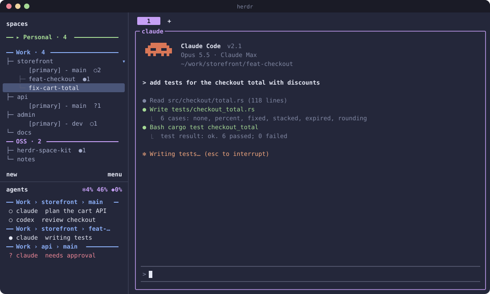

# Space Kit for Herdr

[](https://github.com/quocdaijr/herdr-space-kit/actions/workflows/ci.yml)
[](https://herdr.dev/plugins/)
[](#status)
[](Cargo.toml)
[](herdr-plugin.toml)
[](#status)
[](LICENSE)




A Herdr plugin that organizes Herdr's own sidebar:

- **Workspace groups in Spaces.** Each group gets an empty header workspace (`⟦Group⟧`) followed by its projects, with linked worktrees under their repo. Click a header, or press your fold key, to fold the group; the focused workspace (with its repo, main checkout and worktrees) and anything blocked on you stay visible, marked `▸` (the focused one also says `(open)`), so a peeking row never reads as an unfolded group. The `contains = "▸ "` rule in the config below highlights them.
- **Agent states on every row**, e.g. `├─ storefront  ●2 ○1` (blocked `?`, working `●`, done `✓`, idle `○`). A workspace with worktrees or agents lists its main checkout as a `[primary] - <branch>` row, like a worktree, so its agents never mix with the worktrees'.
- **Agents tab grouped by workspace**: a `━ Group › workspace ━` header on the first agent of each workspace, in sidebar order.
- **Claude / Codex usage in the Agents panel title**, e.g. `✻7% 42% ◆0%` (Claude 5h and 7d, then Codex).
- **A manager popup**: a live tree of groups → spaces → worktrees → agents to create, rename, delete, reorder and fold groups and move spaces between them.

Groups are keyed by path (repo root, else first pane's cwd), so a workspace closed and reopened, or reopened after a server restart, keeps its group.

## Status

**Experimental and vibe-coded.** This plugin was built by prompting an AI coding agent (Claude Code), with the author steering, reviewing and testing it in daily use rather than writing it line by line. It has unit tests and runs on the author's machine, but expect rough edges, read the code before trusting it, and open an issue if something breaks. Like every Herdr plugin, it runs as your user and is not sandboxed.

## Requirements

- Herdr 0.9.1 or newer, on Linux or macOS
- A Rust toolchain (`cargo`): Herdr runs `cargo build --release` when the plugin is linked or installed

## Install

```bash
herdr plugin install quocdaijr/herdr-space-kit
```

Or from a local checkout:

```bash
git clone https://github.com/quocdaijr/herdr-space-kit
herdr plugin link ./herdr-space-kit
```

The plugin is listed in the [Herdr plugin marketplace](https://herdr.dev/plugins/) through the `herdr-plugin` GitHub topic.

## Sidebar config

The plugin reports tokens; `~/.config/herdr/config.toml` decides how they are drawn.

```toml
[ui.sidebar.spaces]
rows = [
  [{ token = "$group_header", fg = "#9a9eb3", bold = true, dim = false }],
  [{ token = "$group_row", fg = "#9a9eb3", bold = false, dim = false, rules = [{ contains = "▸ ", fg = "#e9e9f0", bold = true }] }],
  [{ token = "$group_branch", fg = "#e9e9f0", bold = false, dim = false }],
]

[ui.sidebar.agents]
row_gap = 0
rows = [
  [{ token = "$agent_header", fg = "#9a9eb3", bold = true, dim = false }],
  [{ token = "$agent_line", fg = "#e9e9f0", bold = false, dim = false }],
]
```

Add `rules = [{ contains = "<group>", fg = "<color>" }]` to a cell to color it per group.

| Token | On | Value |
|---|---|---|
| `group_header` | header workspaces | `━━ [▸ ]Group · n[ ●N ?N] ━━━━━━━━━━` |
| `group_row` | every workspace | the whole row as one cell: tree, name, agent counts |
| `group_branch` | workspaces with worktrees or agents | the main checkout as its own row (`[primary] - main  ○2`), lined up with the worktree names, so its agents never mix with the worktrees' |
| `agent_header`, `agent_line` | agent panes | Agents tab rows |
| `agent_sort` | agent panes | sort key of the plugin's agent view |

## Keys

```toml
[[keys.command]]
key = "prefix+f"
type = "plugin_action"
command = "space-kit.toggle-collapse"
description = "fold or unfold this workspace's group"

[[keys.command]]
key = "prefix+ctrl+g"
type = "plugin_action"
command = "space-kit.manage"
description = "space kit manager"
```

In the manager: `j`/`k` move, `Enter` jump and close, `Space` or `h`/`l` fold, `H` fold every group, `L` unfold everything, `n` new group, `r` rename, `d` delete, `m` move a space to a group, `J`/`K` reorder groups, `c` clean assignments whose path is gone, `g` refresh, `?` help, `q`/`Esc` close. Click a fold arrow to fold, double-click a row to jump.

## Usage title

Claude Code only gives its rate limits to its statusline command, so pipe the statusline JSON to the plugin from your statusline script:

```bash
input=$(cat)
sk=/path/to/herdr-space-kit/target/release/space-kit
[ -x "$sk" ] && (printf '%s' "$input" | "$sk" record >/dev/null 2>&1 &)
```

`record` caches the figures in `~/.cache/claude-rate-limits.json` only when they change, then syncs in the background, so the title follows Claude in real time. Codex usage comes from the newest `~/.codex/sessions/**/*.jsonl` at each sync. Without data the title reads `by space`.

## Commands

```text
space-kit sync [--quiet] [--force] [--on-focus]   order the sidebar and report its tokens
space-kit toggle-collapse [--workspace ID]         fold or unfold a workspace's group
space-kit open                                     open the manager popup
space-kit manage                                   run the manager in this terminal
space-kit record                                   cache Claude's statusline rate limits (JSON on stdin)
```

`SPACE_KIT_ROW_WIDTH` overrides the row width (default: `ui.sidebar_width` from config.toml, minus 1).

## Herdr limits worked around

- A plugin cannot hide a workspace, so folding blanks member rows; each still takes one line.
- Rows cannot set a background, so Agents tab rows share their agent's selection highlight.
- Herdr indents rows after an entry's first by two columns; braille blanks (`⠀`) keep rows aligned.
- Tokens and agent views are lost on a server restart; the startup hook resends them.

## State

`~/.local/state/herdr/plugins/space-kit/` (or `$HERDR_PLUGIN_STATE_DIR`):

- `groups.json`: groups (name, color, order) and path → group assignments
- `sidebar.json`: folded groups, the last focused workspace, header workspace ids
- `reported.json`: tokens last sent, so a sync only reports changes
- `headers/<group>/`: the empty folders header workspaces open in
- `view-label.txt`: the Agents panel title last set, so it is only re-sent when it changes
- `sync.lock`, `sync.dirty`: one sync at a time; a request that finds it busy leaves the marker for a rerun
- `groups.v1.json`: the older format, kept once after it was imported
- `space-kit.log`: errors from the manager popup

## Development

```bash
cargo test
cargo fmt --check && cargo clippy --all-targets -- -D warnings
cargo build --release
herdr plugin link "$PWD"
```

CI runs the tests on Linux and macOS, rustfmt and clippy, and fails if line coverage (`cargo llvm-cov`) drops below 80%.

## License

MIT
